# P-MFA Studio

A small Flask + React prototype built to explore how course assignments can be redesigned around **process evidence**, inspired by *Pedagogical Multi-Factor Assessment (P-MFA)* (Hämäläinen & Leiviskä, 2025) and *Arene's AI Traffic Light guidelines* (Blue, Green, Yellow, Red).

> **Note:** This is an R&D prototype using illustrative, synthetic data and examples.

---

## Purpose

Since generative AI can produce a polished output in seconds, grading only the final submission creates a **misalignment problem**: the end product no longer proves what the student actually learned.

**P-MFA Studio** lets a lecturer sanity-check an assignment brief before a course starts and test how process checkpoints feel from a student's side in three quick steps:

1. **Assignment:** Enter learning outcomes, task instructions, an Arene AI Traffic Light tier (*Blue, Green, Yellow, Red*), and optional course rules. Or, load one of four built-in sample scenarios (ICT, Design, Health Care, Business).
2. **Review:** Audits alignment across the six P-MFA dimensions (*Knowledge, Outputs, Application, Process Continuity, Self-Evaluation, Situated Understanding*), anchors observations in wording from the prompt, drafts 3 editable checkpoints plus a student AI disclosure note, and exports a Markdown plan.
3. **Student View:** Lets you try a checkpoint check-in as a student—comparing *Socratic AI coaching* (Blue, Green, Yellow ask probing questions without writing the assignment) against a deterministic Red-tier lockout where the backend refuses to call any LLM.

---

## Screenshots

### 1. Assignment Setup & Arene Traffic Light Selection
Enter learning outcomes, task instructions, and an Arene AI tier (or load one of the four synthetic samples).

<p>
  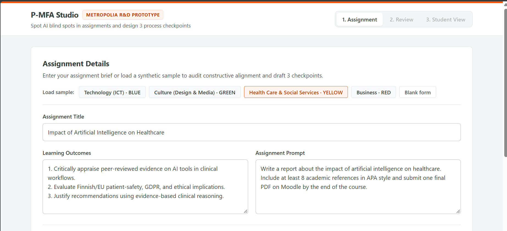<br />
  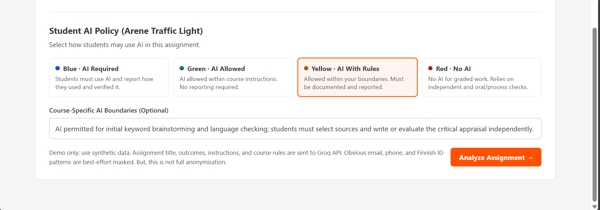
</p>

### 2. Constructive Alignment & Six-Factor P-MFA Audit
Audits the brief against the 6 P-MFA dimensions, anchors ratings in exact prompt wording, and lets the lecturer override any rating.

<p>
  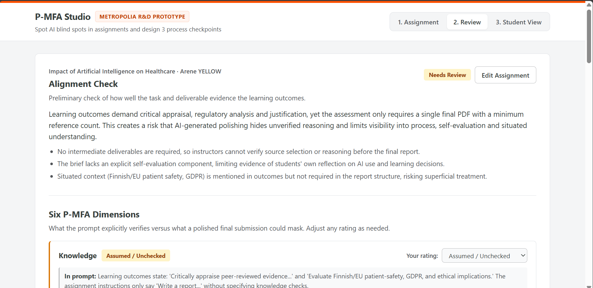<br />
  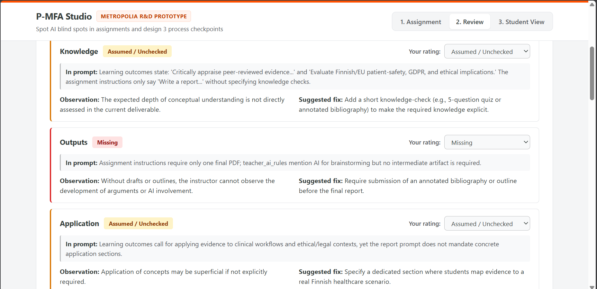
</p>

### 3. Editable Process Checkpoints & Markdown Blueprint Export
Drafts three staged process milestones and a student AI disclosure rule that export directly to a Markdown plan.

<p>
  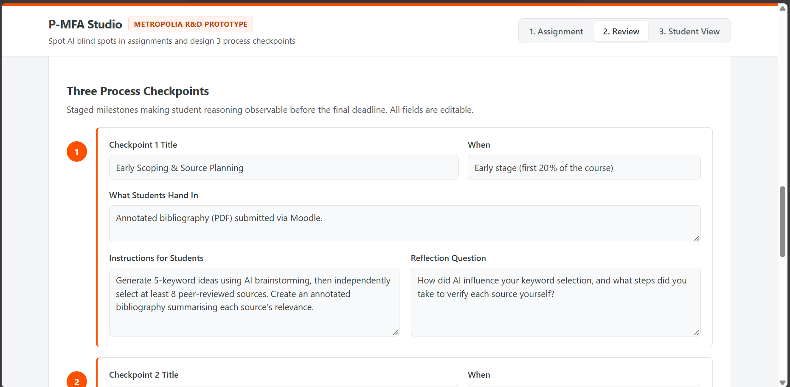<br />
  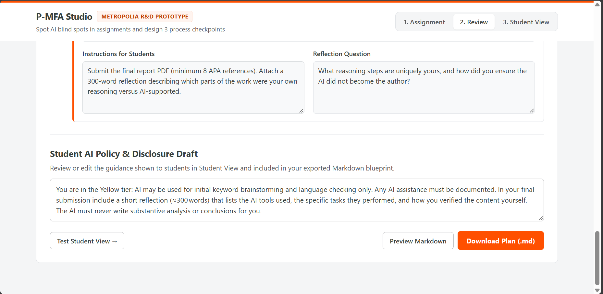
  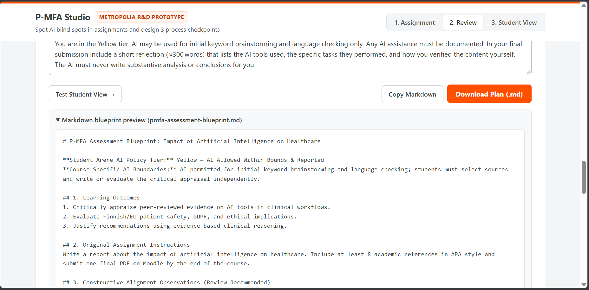
</p>

### 4. Student View — Socratic AI Coach (Yellow Tier)
Students select how they will evidence progress and submit a draft note with AI disclosure; the AI coach asks P-MFA probing questions and evaluates format fit without actually writing the deliverable.

<p>
  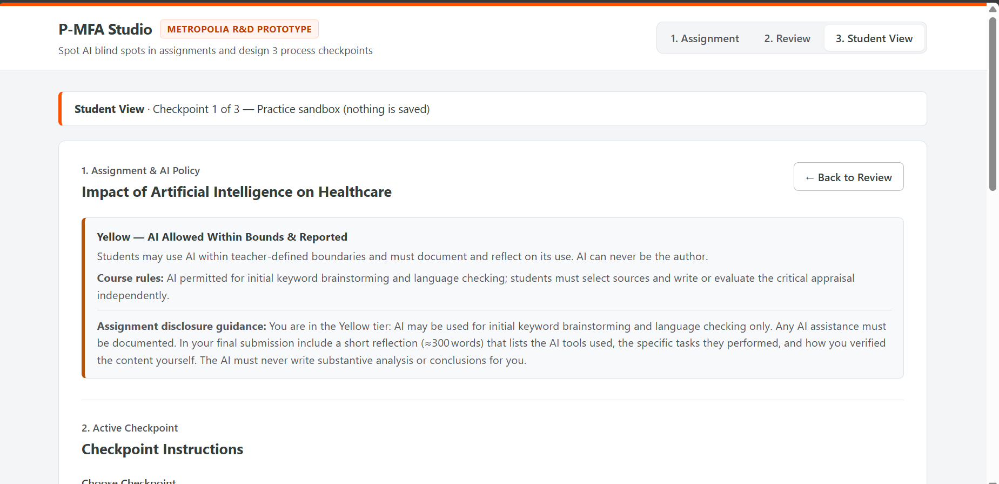<br />
  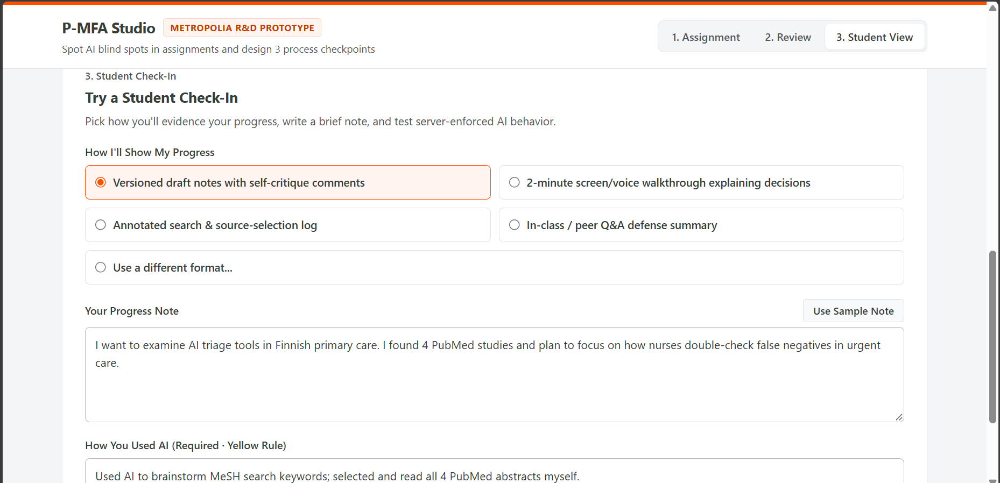<br />
  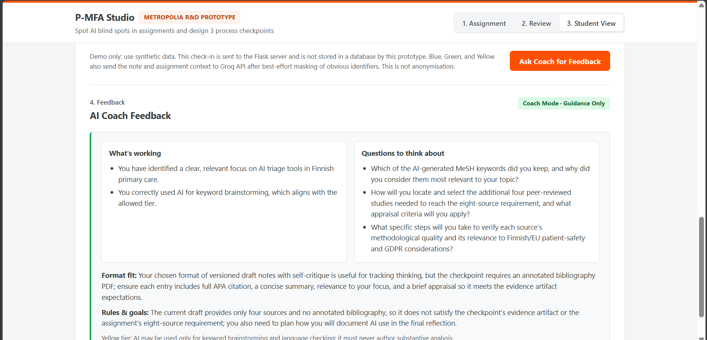
</p>

### 5. Student View — Deterministic Red-Tier AI Lockout
Under the Red (No AI) tier, the Flask backend enforces a hard lockout and returns a self-check checklist without any LLM calls.

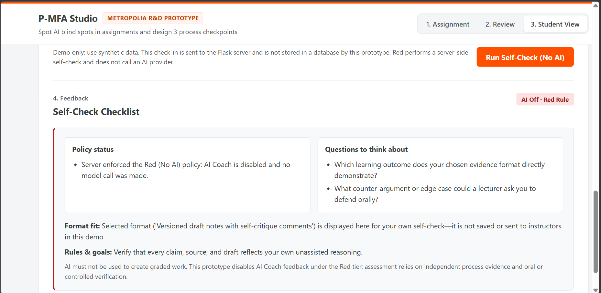

---

## How it's put together

- **Backend (`backend/`):** Flask app factory (`app.py`) serving a small JSON API (`/api/health`, `/api/examples`, `/api/analyze`, `/api/student-checkin`, `/api/export`) plus the built React app (`static_dist/`). Includes a 64 KB payload cap, per-IP sliding-window rate limiting (`SimpleRateLimiter`), strict JSON schema parsing with a retry-on-validation-error loop (`llm_service.py`), and support for both **Groq** and local **Ollama**.
- **Frontend (`frontend/`):** React 18 + Vite 6 single-page app (`AssignmentForm`, `AnalysisBoard`, `StudentPreview`) with inline lecturer overrides, validation before export, and preserved per-checkpoint drafts when switching between Review and Student View.

---

## Running it locally

### 1. Backend
```bash
python -m venv .venv
# Windows PowerShell: .venv\Scripts\Activate.ps1
# Linux/macOS:        source .venv/bin/activate

pip install -r backend/requirements.txt
cp backend/.env.example backend/.env
# Add your GROQ_API_KEY to backend/.env (or set LLM_PROVIDER=ollama for local inference)
```

Start Flask from the project root (serves the prebuilt frontend from `backend/static_dist/`):
```bash
python -m backend.app
# or: flask --app backend.app run
```
Then open `http://127.0.0.1:5000`.

### 2. Frontend
If you want to edit files under `frontend/src/`:
```bash
cd frontend
npm ci
npm run build   # outputs to ../backend/static_dist
```
Or run the Vite dev server alongside Flask for hot reload:
```bash
cd frontend
npm run dev     # proxies /api -> http://127.0.0.1:5000
```

### 3. Tests
```bash
python -m pytest -v
cd frontend && npm test
```

---

## Open R&D questions to explore

- Do short, staged process checkpoints actually make student competence easier to spot without overloading lecturers?
- How consistent are LLMs at catching constructive alignment gaps across different disciplines?
- Which lightweight evidence formats (voice walkthroughs, annotated source logs, short Q&As) are optimal?

---

## Limitations & privacy notes

- **Lecturer judgment stays in charge:** AI audit ratings and prompt quotes are starting suggestions for human review, not verified proof of learning.
- **Synthetic examples only:** Don't paste real student submissions or personal data here. `pii_guard.py` does best-effort regex masking for emails, phone numbers, and Finnish personal IDs before external API calls, but it is **not** full anonymisation or GDPR compliance (e.g. can't catch names or addresses).
- **Hard vs. soft policy enforcement:** Only the Red tier deterministically blocks LLM calls on the server. Custom natural-language course rules (`custom_ai_rules`) and Socratic non-authoring rules are prompt-guided, not unbreakable against adversarial prompts.
- **Prototype scope:** Stateless by design (no database, user accounts, or Moodle integration). Student View runs as an in-browser sandbox without saving drafts, and rate limiting is process-local.

---

## References

- Hämäläinen, M., & Leiviskä, K. (2025). [From NLG Evaluation to Modern Student Assessment in the Era of ChatGPT: The Great Misalignment Problem and Pedagogical Multi-Factor Assessment (P-MFA)](https://aclanthology.org/2025.iwclul-1.1/).

- Arene. (2026). [Arene's recommendations on the use of artificial intelligence for universities of applied sciences](https://arene.fi/wp-content/uploads/2026/05/Arenes-recommendations-on-the-use-of-artificial-intelligence-for-universities-of-applied-sciences.pdf).

- Arene. (2026). [The Traffic Light Model](https://arene.fi/wp-content/uploads/2026/05/AI_The-Traffic-Light-Model_Arene.pdf).

---